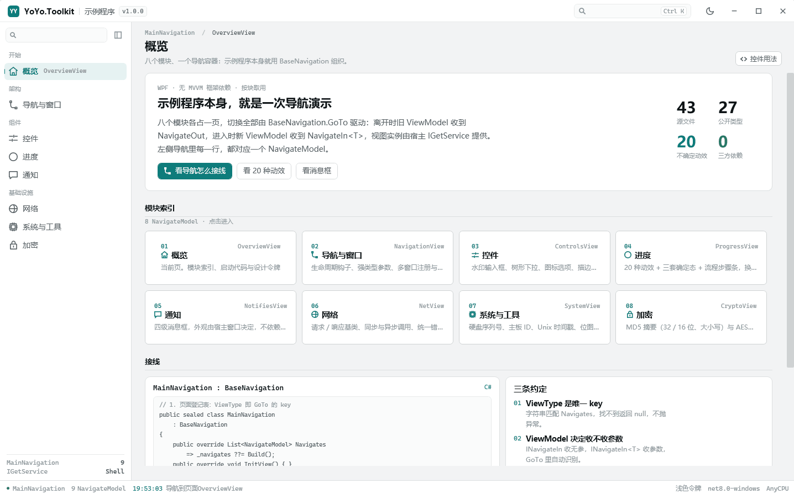
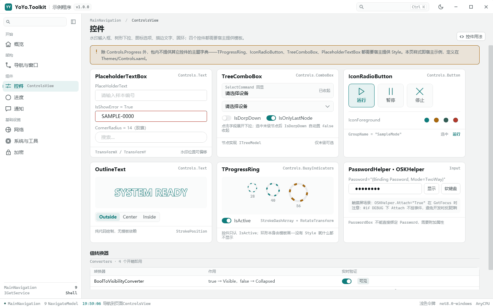
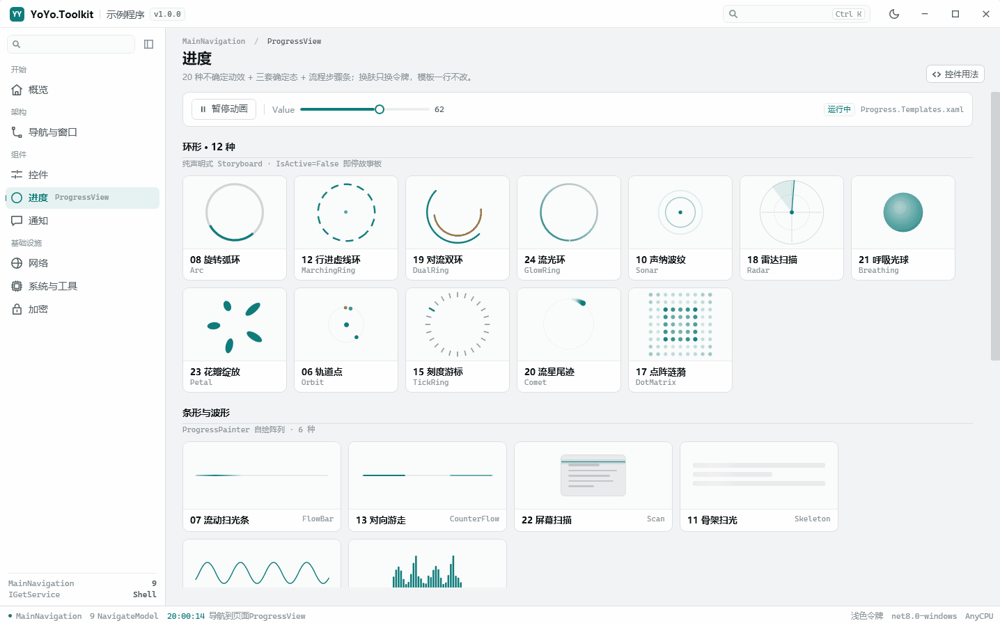

# YoYo.Toolkit

面向 WPF 桌面应用的轻量工具集，为上位机、工控、仪器等「界面 + 设备通信」类项目准备。

全部基于原生 WPF 实现，除 `System.Management` 外无第三方依赖；不引入 MVVM 框架，也不强制目录约定，可按需取用其中任意一块。

- 目标框架：`net6.0-windows`、`net8.0-windows`
- 平台：`AnyCPU` / `x64` / `x86`
- 许可证：MIT

## 特性一览

| 模块 | 命名空间 | 内容 |
| --- | --- | --- |
| 导航 | `YoYo.Toolkit.Navigations` | `BaseNavigation` 页面导航，含进入/离开生命周期钩子与强类型参数 |
| 窗口 | `YoYo.Toolkit.Services` | `WindowService` 多窗口注册、跨线程关闭 |
| 网络 | `YoYo.Toolkit.Net.Http`、`.Pings` | `BaseRequest` / `BaseResponse` 请求基类；`NetworkPing` 连通性检测 |
| 控件 | `YoYo.Toolkit.Controls.*` | 树形下拉、水印输入框、图标选项、描边文字 |
| 进度 | `YoYo.Toolkit.Controls.Progress` | `ProgressIndicator` 20 种动效 + 确定态，`StepTracker` 流程步骤条，自带主题字典与浅/深令牌，开箱即用且可整体重写 |
| 附加行为 | `YoYo.Toolkit.Input`、`.Animations` | `PasswordHelper` 密码绑定；`OSKHelper` 触摸屏软键盘 |
| 通知 | `YoYo.Toolkit.Notifies` | `TMessageBox` 可换肤消息框 |
| 系统 | `YoYo.Toolkit.System`、`.WinApis` | 硬盘序列号、主板 ID、机器名；`Kernel32.CopyMemory` |
| 加密 | `YoYo.Toolkit.CryptoServices` | `MD5Helper` 摘要；`RSAHelper` AES/RSA 加解密 |
| 工具 | `YoYo.Toolkit.Time`、`.Images`、`.Converters` | Unix 时间戳、位图加载、常用值转换器 |

## 界面预览

示例程序三个页面的实际操作录屏（GIF 自动播放，点击看大图）：

| 导航 · 页面切换 | 控件 · 主题控件 | 进度 · 20 种动效 |
| :---: | :---: | :---: |
| <a href="screenshots/navigation.gif"></a> | <a href="screenshots/controls.gif"></a> | <a href="screenshots/progress.gif"></a> |

## 安装

```bash
dotnet add package YoYo.Toolkit
```

或在 `PackageReference` 中指定版本：

```xml
<PackageReference Include="YoYo.Toolkit" Version="1.0.0" />
```

宿主项目需启用 WPF：

```xml
<PropertyGroup>
  <UseWPF>true</UseWPF>
</PropertyGroup>
```

## 快速开始

### 1. 页面导航

导航以 `IGetService` 为底座，视图与 ViewModel 都由外部容器提供，包本身不绑定任何 DI 框架。

```csharp
public sealed class ShellService : IGetService
{
    private readonly IServiceProvider _provider;
    private FrameworkElement? _view;

    public ShellService(IServiceProvider provider) => _provider = provider;

    public object GetService(Type? t) => _provider.GetService(t!)!;
    public FrameworkElement? GetView() => _view;
    public void SetView(FrameworkElement? view) => _view = view;
}

public sealed class MainNavigation : BaseNavigation
{
    public MainNavigation(IGetService service) : base(service) { }

    public override string NavigationName => "Main";

    public override List<NavigateModel> Navigates { get; } = new()
    {
        new NavigateModel
        {
            ViewType = "HomeView",
            Type = typeof(HomeView),
            VMType = typeof(HomeViewModel),
            Name = "首页",
        },
        new NavigateModel
        {
            ViewType = "DeviceView",
            Type = typeof(DeviceView),
            VMType = typeof(DeviceViewModel),
            Name = "设备",
        },
    };

    public override void InitView() { }
    public override void LogWrite(string? msg) { }
    public override void LogWrite(string? msg, Exception? exception) { }
}
```

页面 ViewModel 实现 `INavigateIn` / `INavigateIn<T>` / `INavigateOut`，即可在切换时收到回调：

```csharp
public sealed class DeviceViewModel : INavigateIn<string>, INavigateOut
{
    public void NavigateIn(string? deviceId) { /* 初始化并加载 deviceId */ }
    public void NavigateOut() { /* 停止轮询、释放资源 */ }
}

// 跳转
navigation.GoTo("DeviceView", "SN-0001");
navigation.GoTo("HomeView");
```

### 2. HTTP 请求

继承 `BaseRequest` 描述接口，继承 `BaseResponse` 描述返回，序列化方式可自行覆盖。

```csharp
public sealed class LoginRequest : BaseRequest
{
    public override string RootUrl => "https://api.example.com";
    public override string BusinessUrl => "/api/login";
    public override HttpMethodTypes Method => HttpMethodTypes.POST;
    public override Type ResponseType => typeof(LoginResponse);

    public string User { get; set; } = string.Empty;
    public string Password { get; set; } = string.Empty;

    public override void SerializeObject()
        => Data = JsonSerializer.Serialize(new { User, Password });
}

public sealed class LoginResponse : BaseResponse
{
    public string Token { get; private set; } = string.Empty;

    public override void DeserializeObj()
    {
        using var doc = JsonDocument.Parse(Data);
        var root = doc.RootElement;
        IsOk = root.GetProperty("code").GetInt32() == 0;
        Msg = root.TryGetProperty("msg", out var msg) ? msg.GetString() ?? string.Empty : string.Empty;
        if (IsOk && root.TryGetProperty("token", out var token))
            Token = token.GetString() ?? string.Empty;
    }
}
```

异步调用（内部使用 `BackgroundWorker`，回调回到 UI 线程）：

```csharp
var request = new LoginRequest { User = "admin", Password = "123456" };
request.DoServiceAsyncCompleted += response => { /* 处理结果 */ };
request.Error += (message, ex) => { /* 统一错误处理 */ };
request.DoWorkerAsync();

// 同步调用
var syncResponse = request.DoWorkerSync();
```

支持的请求方式：`GET`、`POST`、`PUT`、`DELETE`，以及带 Body 的 `GetBody`。鉴权头可在 `SetHeader(HttpClient)` 中统一注入；请求前后的等待界面通过重写 `ShowProcess()` / `CloseProcess()` 接管，`IsShowProcess` 控制是否启用。

### 3. 控件

```xml
<Window xmlns:yy="clr-namespace:YoYo.Toolkit.Controls.Text;assembly=YoYo.Toolkit"
        xmlns:busy="clr-namespace:YoYo.Toolkit.Controls.BusyIndicators;assembly=YoYo.Toolkit"
        xmlns:btn="clr-namespace:YoYo.Toolkit.Controls.Button;assembly=YoYo.Toolkit">
  <StackPanel>
    <!-- 水印输入框 -->
    <yy:PlaceholderTextBox PlaceHolderText="请输入样本编号" />

    <!-- 环形进度，可在模板中用 VisualState 驱动 -->
    <busy:TProgressRing IsActive="True" Width="36" Height="36" />

    <!-- 图标 + 文字的选项按钮 -->
    <btn:IconRadioButton Icon="&#xE7BA;" Content="运行" GroupName="Mode" />

    <!-- 描边文字 -->
    <yy:OutlineText Text="SYSTEM READY" StrokePosition="Outside" />
  </StackPanel>
</Window>
```

树形下拉要求节点实现 `ITreeModel`（`DisplayName`、`HasChildren()`），选中后可通过 `SelectCommand` 回传节点：

```xml
<combo:TreeComboBox ItemsSource="{Binding Devices}"
                    IsDorpDown="True"
                    IsOnlyLastNode="True"
                    SelectCommand="{Binding SelectDeviceCommand}" />
```

> **注意**：除 `Controls.Progress` 之外，本包不内置其它控件的主题资源字典。`TProgressRing`、`IconRadioButton` 等通过 `DefaultStyleKey` 查找样式的控件，需要在宿主应用中提供 `Style` / `ControlTemplate`，否则控件不会呈现内容。`OutlineText`、`PlaceholderTextBox` 以代码绘制为主，可直接使用。进度控件的样式与模板随包提供（`Themes/Generic.xaml`），merge 后即可用，详见 [8. 进度控件](#8-进度控件)。

### 4. 消息框

`TMessageBox` 不依赖系统 `MessageBox`，外观由你提供的窗口决定：

```csharp
// 启动时注册弹窗实现，构造函数须为 (string caption, string msg, MessageLevel level)
TMessageBox.Init(typeof(MyMessageDialog));

var result = TMessageBox.ShowMsg("提示", "确认开始运行？", TMessageBox.MessageLevel.Question);
if (result == TMessageBox.TMessageBoxResult.OK)
{
    // ...
}
```

`MyMessageDialog` 继承 `BaseMessageDialog`，在关闭前给 `MessageBoxResult` 赋值即可。

### 5. 设备与授权

```csharp
SystemHelper.Init();                       // 读取硬盘序列号、主板 ID、机器名
var diskId = SystemHelper.HardDiskID;      // 可用于授权绑定
var boardId = SystemHelper.ServerId;
var machine = SystemHelper.ComputerName;

var reachable = await NetworkPing.PingHost("192.168.1.10") is not null;

var md5 = MD5Helper.Md5("hello");
var cipher = RSAHelper.AESEncrypt("plain-text", "your-key");
```

> `NetworkPing.PingHost` 返回 `PingReply?`，不可达时返回 `null` 而不抛异常。
> 注意 `PingReply.Options` **可能为 `null`**（本机回环、IPv6 链路本地地址、部分虚拟网卡只回 ICMP 不带 IP 选项），
> 直接取 `reply.Options.Ttl` 会抛 `NullReferenceException`——工具内部已做空值保护，取值失败时退化为占位符。

> 加解密示例仅作接口参考。用于生产环境前，请自行确认密钥管理、IV 与填充模式是否符合你的安全要求。

### 6. 密码框绑定

```xml
<PasswordBox input:PasswordHelper.Attach="True"
             input:PasswordHelper.Password="{Binding Password, Mode=TwoWay}" />
```

### 7. 值转换器

```xml
<ResourceDictionary xmlns:conv="clr-namespace:YoYo.Toolkit.Converters;assembly=YoYo.Toolkit">
  <conv:BoolToVisibilityConverter x:Key="BoolToVis" />
  <conv:BoolToReverseConverter x:Key="BoolReverse" />
  <conv:NullToVisibilityConverter x:Key="NullToVis" />
</ResourceDictionary>
```

### 8. 进度控件

进度控件是唯一自带主题资源的模块：`Themes/Generic.xaml` 里两个隐式样式在宿主 merge 后自动生效，**开箱即用、无需写样式**，同时保留四条自上而下的重写通道。

```xml
<Window xmlns:p="clr-namespace:YoYo.Toolkit.Controls.Progress;assembly=YoYo.Toolkit">
  <StackPanel>
    <!-- 不确定：只要一个枚举值 -->
    <p:ProgressIndicator Kind="Arc" IsActive="True" Width="40" Height="40" />
    <p:ProgressIndicator Kind="Signal" IsActive="True" StatusText="正在采集" Width="190" Height="44" />

    <!-- 确定：Value 走 Minimum/Maximum，Percent 只读输出 0~1 -->
    <p:ProgressIndicator Kind="FlowBar" IsIndeterminate="False"
                         Minimum="0" Maximum="100" Value="62"
                         Width="180" Height="20" />

    <!-- 流程步骤条 -->
    <p:StepTracker Steps="{Binding Steps}" CurrentIndex="{Binding CurrentStep}" />
  </StackPanel>
</Window>
```

`StepTracker` 默认 `HorizontalAlignment="Stretch"`：每个步骤占一个等宽单元格（内部是 `UniformGrid` + 左右半段连接线），步数与标签长度变化都不会撑破容器，也不会把末步文字裁掉。竖排时把 `Orientation` 设为 `Vertical` 即可，模板会自动切换成"节点在上、标签在下"的项模板。

#### 20 种不确定动效

| 分组 | Kind |
| --- | --- |
| 环形（12） | `Arc` 旋转弧环、`MarchingRing` 行进虚线环、`DualRing` 对流双环、`GlowRing` 流光环、`Sonar` 声纳波纹、`Radar` 雷达扫描臂、`Breathing` 呼吸光球、`Petal` 花瓣绽放、`Orbit` 轨道点、`TickRing` 刻度游标环、`Comet` 流星尾迹、`DotMatrix` 点阵涟漪 |
| 条形与波形（6） | `FlowBar` 流动扫光条、`CounterFlow` 对向游走、`Scan` 屏幕扫描、`Skeleton` 骨架扫光、`Wave` 行波线、`Signal` 信号带 |
| 行内小型（2） | `BounceDots` 三点脉动、`Typing` 打字省略号 |

其中 14 套是纯声明式（模板里的 `Storyboard` 推导动画），6 套由 `ProgressPainter` 自绘参数化阵列（`Signal` / `Ticks` / `TicksProgress` / `Wave` / `Matrix` / `Comet`），阵列的相位由 `Phase` 属性驱动，因此新增一种阵列只需加一个 `Render*` 方法和一个枚举值，不必再写一套 XAML。

#### 确定态

`IsIndeterminate="False"` 时按 `Minimum` / `Maximum` / `Value` 计算 `Percent`。内置三套确定态模板：`FlowBar.Determinate`（条形）、`Arc.Determinate`（环形弧）、`TickRing.Determinate`（分段刻度），中央自动显示百分比。其它 Kind 会自动回落到这三者之一（`DeterminateFallback`）。

边界行为：`0` 时弧线与分段全部不点亮、条形宽度为 0；`1` 时整圆闭合；`Maximum == Minimum` 时 `Percent` 返回 0，不抛除零异常。

#### 状态与动效强度

`State` 走 `VisualStateManager`，状态组固定名为 `ProgressStates`，成员为 `Idle` / `Running` / `RunningReduced` / `Success` / `Error` / `Paused`。

- `IsActive` 是 `State` 的便捷开关：`State` 仍为 `Idle` 而 `IsActive="True"` 时按 `Running` 处理。
- `Motion="Reduced"` 走 `RunningReduced` 分支，模板里只放静态态即可实现「减少动效」的无障碍降级。
- `Success` / `Error` 用于跑完的收尾态，兜底模板会显示勾 / 叉。

#### 换肤：只换令牌，不动模板

```xml
<Application.Resources>
  <ResourceDictionary>
    <ResourceDictionary.MergedDictionaries>
      <!-- 深色皮肤：整包替换令牌，模板一行不改 -->
      <ResourceDictionary Source="pack://application:,,,/YoYo.Toolkit;component/Themes/Progress.Tokens.Dark.xaml" />
    </ResourceDictionary.MergedDictionaries>
  </ResourceDictionary>
</Application.Resources>
```

令牌分四组，浅深两版键名完全一致：`Progress.Brush.*`（Accent / AccentSoft / Secondary / Track / Guide / Success / Error / OnAccent / Surface / Ink / InkSecondary / InkDim）、`Progress.Thickness.*`、`Progress.Duration.*`、`Progress.Opacity.*` / `Progress.Size.*` / `Progress.Font.Caption`。

只想改主色而不换整套皮肤时，直接在宿主资源里覆盖单个键，或对单实例设 `AccentBrush`：

```xml
<p:ProgressIndicator Kind="Arc" IsActive="True" AccentBrush="#B4700F" />
```

#### 自定义模板的四条通道

按优先级从高到低，命中即止：

| 通道 | 做法 | 适用 |
| --- | --- | --- |
| 1. 显式 `Template` | `<p:ProgressIndicator.Template>` 或样式 `Setter` | 单处特例 |
| 2. `TemplateKey` | `TemplateKey="My.BrandLoading"`，指向宿主任意 `ControlTemplate` | 设计稿新增动效，不扩充枚举 |
| 3. 覆盖 `Progress.Template.{Kind}.{Indeterminate\|Determinate}` | 在宿主资源里定义同名键 | 整套替换某个 Kind |
| 4. 覆盖 `Progress.Template.Default` | 兜底模板 | 全局统一风格 |

第 3、4 条能生效，靠的是 WPF 对 `MergedDictionaries` 的**倒序查找**：`ProgressTheme` 把自带的模板字典 `Insert(0, ...)` 插到宿主字典列表最前面，宿主后 merge 的同名资源因此优先命中。

自己写模板时遵守三条约定即可正常驱动动画：

```xml
<ControlTemplate x:Key="My.BrandLoading" TargetType="{x:Type p:ProgressIndicator}">
  <Grid x:Name="PART_Root" Background="Transparent">
    <VisualStateManager.VisualStateGroups>
      <VisualStateGroup x:Name="ProgressStates">
        <VisualState x:Name="Idle" />
        <VisualState x:Name="Running">
          <Storyboard>
            <DoubleAnimation Storyboard.TargetName="Spin"
                             Storyboard.TargetProperty="(RotateTransform.Angle)"
                             From="0" To="360"
                             Duration="{DynamicResource Progress.Duration.Base}"
                             RepeatBehavior="Forever" />
          </Storyboard>
        </VisualState>
        <VisualState x:Name="RunningReduced" />
        <VisualState x:Name="Success" />
        <VisualState x:Name="Error" />
        <VisualState x:Name="Paused" />
      </VisualStateGroup>
    </VisualStateManager.VisualStateGroups>

    <Ellipse Width="40" Height="40" StrokeThickness="3"
             Stroke="{Binding AccentBrush, RelativeSource={RelativeSource TemplatedParent}}"
             StrokeDashArray="2 3" RenderTransformOrigin="0.5,0.5">
      <Ellipse.RenderTransform>
        <RotateTransform x:Name="Spin" />
      </Ellipse.RenderTransform>
    </Ellipse>
  </Grid>
</ControlTemplate>
```

1. 根元素必须是 `Grid`（或任意 `FrameworkElement`），第一列放视觉、第二列放状态文案。
2. 状态组必须叫 `ProgressStates`，六个状态名一个都不能少——`VisualStateManager` 找不到对应状态时会静默跳过，动画看起来就「不动」。
3. `Storyboard.TargetProperty` 指向 `RotateTransform` / `ScaleTransform` / `TranslateTransform` 时，路径要带类型限定符（`(RotateTransform.Angle)` 而不是 `Angle`）。不带限定符在部分模板里能过，但换到另一套变换就会在 `OnApplyTemplate` 阶段抛 `无法解析属性路径中的所有属性引用`。

> ⚠️ **命名空间冲突**：本包根命名空间是 `YoYo.Toolkit`，其下已有 `YoYo.Toolkit.System` 等子命名空间。宿主工程若命名为 `YoYo.Toolkit.Sample`、`YoYo.Toolkit.Demo` 这类**以 `YoYo.Toolkit` 为前缀**的名字，XAML 编译时会把你写的 `System.Windows.*` 解析到 `YoYo.Toolkit.System`，报 `CS0234: 命名空间"YoYo.Toolkit.System"中不存在类型或命名空间名"Windows"`。示例工程因此叫 `YoYo.ToolkitSample`（无点号），宿主请避开 `YoYo.Toolkit.*` 前缀。

## 项目结构

```
YoYo.Toolkit/
├─ Animations/      动画附加属性
├─ Controls/
│  ├─ Progress/     ProgressIndicator、ProgressPainter、StepTracker
│  └─ ...           BusyIndicators、Button、ComboBox、Text
├─ Converters/      百分比 → 弧线几何 / 百分比文案、Bool / Null 与 Visibility
├─ CryptoServices/  MD5、RSA(AES)
├─ Images/          位图加载扩展
├─ Input/           PasswordBox 绑定、触摸屏软键盘
├─ Interfaces/      窗口与导航接口
├─ Models/          NavigateModel
├─ Navigations/     BaseNavigation
├─ Net/             HTTP 基类、Ping
├─ Notifies/        TMessageBox
├─ Services/        WindowService
├─ System/          硬件与机器信息
├─ Themes/          Generic.xaml、Progress.Tokens.Light/Dark.xaml、Progress.Templates.xaml
├─ Time/            Unix 时间戳
└─ WinApis/         kernel32 互操作

YoYo.Toolkit.Sample/          示例程序（工程名不能带 . 前缀，见上文命名空间冲突）
├─ Themes/          Tokens.Light/Dark.xaml（令牌）、Styles.xaml（外壳）、Controls.xaml（宿主模板）
├─ Navigations/     MainNavigation：9 个 NavigateModel，DeviceView 不进侧栏
├─ Services/        ShellService：IGetService 的宿主实现，页面单例
├─ ViewModels/      Shell + 8 页 + DeviceViewModel（演示 INavigateIn<T>）
├─ Views/           8 个 UserControl + MyMessageDialog（BaseMessageDialog 子类）
├─ Net/             BaseRequest / BaseResponse 的四个示例子类
└─ MainWindow.xaml  WindowChrome 自绘标题栏 + 侧栏 + 页头 + 状态栏
```

示例工程见 `YoYo.Toolkit.Sample`。运行 `YoYo.Toolkit.Sample.exe` 即可打开演示页。

## 构建与打包

```bash
# 构建
dotnet build YoYo.Toolkit/YoYo.Toolkit.csproj -c Release -p:Platform=x64

# 打包
dotnet pack YoYo.Toolkit/YoYo.Toolkit.csproj -c Release -p:Platform=x64 -o artifacts
```

## 许可证

[MIT](LICENSE) © 2025 在梦想路上狂奔的蜗牛
